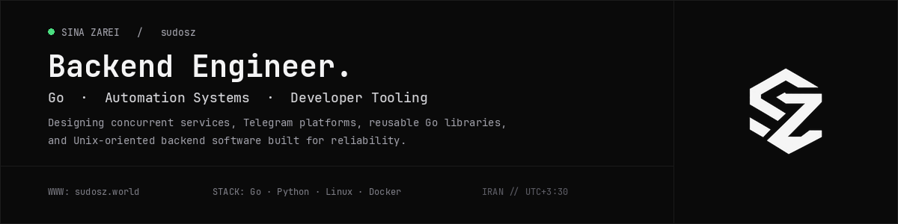
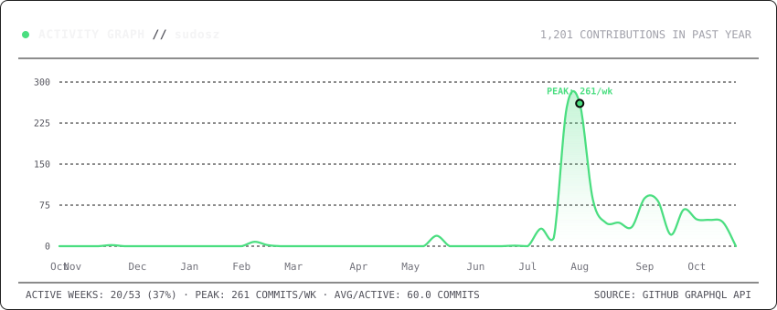

<div align="center">



<br /><br />

# Sina Zarei

**Backend Engineer** &nbsp;·&nbsp; `Go` &nbsp;·&nbsp; `Automation Systems` &nbsp;·&nbsp; `Developer Tooling`

<br />

<a href="https://www.sudosz.world">
  
</a>
&nbsp;
<a href="https://www.sudosz.world/SinaZarei.pdf">
  
</a>
&nbsp;
<a href="https://t.me/sudosz">
  
</a>
&nbsp;
<a href="mailto:me@sudosz.world">
  
</a>

<br /><br />

```
"I design and build backend services, concurrent processing pipelines,
 Telegram platforms, reusable Go libraries, and Linux-oriented systems."
```

</div>

---

### Capabilities

<table width="100%">
  <tr>
    <td width="33%" valign="top">
      <h4><code>01 // GO BACKEND</code></h4>
      <p>Concurrent worker pools, idiomatic REST services, layered service architecture, generics, and reusable libraries engineered for production predictability.</p>
    </td>
    <td width="33%" valign="top">
      <h4><code>02 // AUTOMATION SYSTEMS</code></h4>
      <p>High-throughput Telegram architectures, asynchronous task dispatching, background queues with Redis, and resilient data processing pipelines.</p>
    </td>
    <td width="33%" valign="top">
      <h4><code>03 // LINUX & TOOLING</code></h4>
      <p>Unix CLI utilities, containerization with Docker, process orchestration, CI/CD pipelines, and infrastructure observability.</p>
    </td>
  </tr>
</table>

---

### Selected Projects

<table width="100%">
  <tr>
    <td width="50%" valign="top">
      <h4><a href="https://github.com/sudosz/tg-state-manager"><code>tg-state-manager</code></a></h4>
      <p><strong>Reusable Go library for stateful Telegram workflows</strong></p>
      <p>Generic state transitions, in-memory and Redis-backed storage backends, concurrency-safe handlers, and framework-agnostic integration.</p>
      <p><code>Go</code> · <code>Generics</code> · <code>Redis</code> · <code>Concurrency</code></p>
    </td>
    <td width="50%" valign="top">
      <h4><a href="https://github.com/NamiraNet/namira-core"><code>namira-core</code></a></h4>
      <p><strong>Asynchronous network configuration processing engine</strong></p>
      <p>Parsing, validation, and scoring pipeline combining concurrent worker pools, Redis task dispatching, and CLI/API interfaces.</p>
      <p><code>Go</code> · <code>Worker Pools</code> · <code>Redis</code> · <code>Docker</code></p>
    </td>
  </tr>
  <tr>
    <td width="50%" valign="top">
      <h4><a href="https://github.com/sudosz/fruits-api"><code>fruits-api</code></a></h4>
      <p><strong>Production-minded reference backend architecture</strong></p>
      <p>Layered architecture with Gin and PostgreSQL, clean interface boundaries, database migrations, container hardening, Kubernetes manifests, and Helm charts.</p>
      <p><code>Go</code> · <code>Gin</code> · <code>PostgreSQL</code> · <code>Kubernetes</code> · <code>Helm</code> · <code>CI/CD</code></p>
    </td>
    <td width="50%" valign="top">
      <h4><a href="https://github.com/sudosz/neghab"><code>neghab</code></a></h4>
      <p><strong>Linux networking & system observation utility</strong></p>
      <p>Experimental systems tool for controlled traffic generation, <code>/proc/net/dev</code> metric extraction, process lifecycle management, and Linux automation.</p>
      <p><code>Go</code> · <code>Linux</code> · <code>Networking</code> · <code>Systems Programming</code></p>
    </td>
  </tr>
</table>

---

### Activity & Stats

<table width="100%">
  <tr>
    <td width="50%" align="center" valign="middle">
      <a href="https://github.com/sudosz">
        
      </a>
    </td>
    <td width="50%" align="center" valign="middle">
      <a href="https://github.com/sudosz">
        
      </a>
    </td>
  </tr>
</table>

<p align="center">
  
</p>

---

### Toolbox

```
Core            Go · Python · Linux · Docker · Git · Redis
Backend & APIs  Gin · Fiber · net/http · FastAPI · REST APIs · gRPC
Data & Storage  PostgreSQL · MySQL · Redis · MongoDB · SQLite
Infra & DevOps  Docker · GitHub Actions · CI/CD · Kubernetes · Helm · Linux / Bash
```

---

### Currently

- Developing a private web platform with a custom Go backend service and frontend interface.
- Exploring systems programming, high-throughput network pipelines, and operational telemetry.
- Maintaining open-source Go packages and modular developer tools.
- Open to thoughtful backend engineering roles and infrastructure collaborations.

<br />

<div align="center">

```
sudosz.world  •  Sina Zarei  •  Mashhad, Iran (UTC+3:30)
```

</div>
